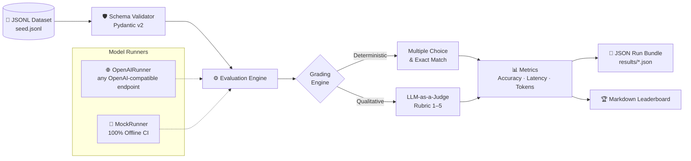

# chilango-bench

**A reproducible benchmark for evaluating LLMs on Mexican Spanish** — slang, cultural literacy, civic procedures, and wordplay (*albur*).

[](https://github.com/DiegoTepichin/chilango-bench/actions/workflows/ci.yml)
[](https://github.com/DiegoTepichin/chilango-bench)
[](https://mypy.readthedocs.io)
[](https://github.com/astral-sh/ruff)
[](LICENSE)

> **Status: pre-release.** The harness works end to end, but the seed dataset has not been human-reviewed yet and no real model results have been published. Do not cite scores from this repository yet.

---

## Why

Standard Spanish NLP benchmarks evaluate formal Castilian or generic Latin American Spanish. They miss the pragmatic reality of Mexican Spanish — spoken by over 130 million people. An LLM failing to distinguish *"¡cámara!"* (agreement/goodbye) from a camera apparatus, or hallucinating SAT procedures vs. RENAPO workflows, breaks real-world trust.

`chilango-bench` provides a deterministic, reproducible evaluation suite to score and compare models before deploying them in Mexico.

## Architecture



## Benchmark dimensions

| Category | Description |
| :--- | :--- |
| **Slang** | Colloquial lexicon, pragmatic discourse markers, register shifts (*chilangismos*) |
| **Cultural context** | CDMX Metro system, traditions, urban geography, food |
| **Procedures** | Real-world admin navigation: SAT, CURP, RFC, e.firma, licencias |
| **Albur** | Wordplay, innuendo detection, double entendre resolution |

The seed dataset (`v0.1`) ships with 40 multiple-choice items, 10 per category, with answer keys spread evenly across A–D. Every item is marked `review_status: unreviewed` until a human verifies it.

## Quickstart

Requires Python 3.11+ and [`uv`](https://docs.astral.sh/uv/).

```bash
git clone https://github.com/DiegoTepichin/chilango-bench.git
cd chilango-bench
uv sync
```

### Validate dataset

```bash
uv run chilango-bench validate datasets/v0.1/seed.jsonl
```

### Run evaluation

```bash
# Offline mock run (no API key needed)
uv run chilango-bench eval \
  --dataset datasets/v0.1/seed.jsonl \
  --model mock-model \
  --provider mock \
  --output results/mock-run.json

# OpenAI-compatible endpoint (set OPENAI_BASE_URL for providers other than OpenAI)
export OPENAI_API_KEY="your-api-key"
uv run chilango-bench eval \
  --dataset datasets/v0.1/seed.jsonl \
  --model gpt-4o-mini \
  --output results/gpt-4o-mini.json
```

### Generate leaderboard

```bash
uv run chilango-bench leaderboard --results-dir results
```

## Leaderboard

No results yet. Real model runs will be published here, each backed by its JSON run report, once the seed dataset has been reviewed.

## Development

```bash
uv run ruff check .          # lint
uv run ruff format --check . # format
uv run mypy .                # type check
uv run pytest                # test suite (100% offline)
```

All checks must pass before merging. CI runs the full matrix across Python 3.11–3.14.

## License

[MIT](LICENSE)
