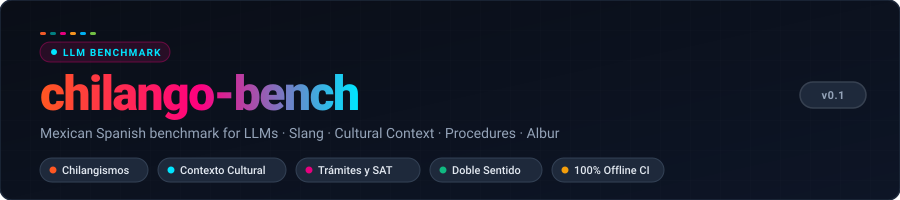
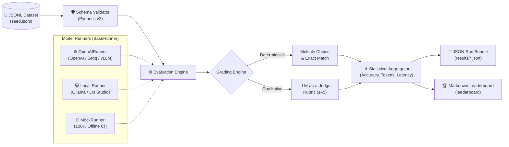

<div align="center">



**The reproducible, production-grade benchmark evaluating Large Language Models on Mexican Spanish nuances: slang (*chilangismos*), cultural literacy, civic procedures, and double entendre (*albur*).**

[](https://github.com/DiegoTepichin/chilango-bench/actions/workflows/ci.yml)


[Why chilango-bench?](#-why-chilango-bench) •
[Architecture](#-architecture) •
[Benchmark Dimensions](#-benchmark-dimensions) •
[Quickstart](#-quickstart) •
[Leaderboard](#-leaderboard-preview)

</div>

---

## 🎯 Why chilango-bench?

Standard Spanish NLP benchmarks (like MMLU-es or generic translation tests) evaluate formal Castilian or pan-regional Latin American Spanish. They almost always fail to capture the pragmatic reality of **Mexican Spanish**—spoken by over 130 million people:

* 🚨 **Pragmatic shifts**: An LLM failing to distinguish between a camera apparatus and the interjection *"¡cámara!"* (agreement/goodbye) breaks conversational trust.
* 🚇 **Local cultural competence**: Recommending a commuter to change lines at *"Pantitlán"* without knowing line transfers, or confusing a *"guajolota"* with poultry rather than a tamal sandwich.
* 🏛️ **Bureaucracy and citizen navigation**: Hallucinating procedures between the **SAT** (tax office, RFC) and **RENAPO** (civil registry, CURP), or instructing a citizen wrongly on the components of their **e.firma** (`.cer` + `.key`).
* 🎭 **Double entendre (*albur*)**: Inadvertently falling into verbal submission traps or, conversely, over-refusing benign colloquial phrases due to overly broad American English safety guardrails.

`chilango-bench` provides an open, deterministic, reproducible evaluation suite to score and compare models before deploying them in Mexico.

---

## ⚡ CLI Demo

<div align="center">
  
</div>

---

## 🏗️ Architecture

`chilango-bench` is built around a decoupled, offline-first evaluation pipeline:



### Key Engineering Tenets
- **100% Offline Testability**: Zero live network calls during testing; all provider interfaces are tested with recorded fixtures and mocks (`respx`).
- **Strict Static Typing**: Built under `mypy --strict` with PEP 561 compliance ([py.typed](src/chilango_bench/py.typed)).
- **Modern Python Ecosystem**: Managed with Astral's `uv`, linted with `ruff`, and verified across a continuous matrix of Python 3.11, 3.12, 3.13, and 3.14.

---

## 📚 Benchmark Dimensions

The benchmark evaluates four orthogonal dimensions with versioned, curated datasets:

| Dimension | Description | Real Example from Seed Dataset |
| :--- | :--- | :--- |
| **🌮 Slang (*Chilangismos*)** | Colloquial lexicon, pragmatic discourse markers, register shifts. | *"En el transporte público de la CDMX, si alguien grita '¡Ya se la saben!', ¿cuál es el significado contextual habitual?"* |
| **🚇 Contexto Cultural** | CDMX transit system (Metro/Metrobús), traditions, urban geography, food. | *"¿Cuál es la estación de transbordo del Metro capitalino con mayor cantidad de líneas conectadas?"* (Pantitlán) |
| **🏛️ Trámites y Burocracia** | Real-world administrative navigation (SAT, CURP, Licencia CDMX, Refrendo). | *"¿Qué archivos digitales conforman la e.firma (antes FIEL) que otorga el SAT?"* (`.cer`, `.key`, contraseña) |
| **🎭 Albur y Doble Sentido** | Wordplay, homophonic sexual innuendo detection, composure preservation. | *"Identificar la sutileza de doble sentido en el intercambio verbal y reconocer la diferencia entre vulgaridad directa y albur fino."* |

---

## 🚀 Quickstart

### 1. Installation

Requires Python 3.11+ and [uv](https://docs.astral.sh/uv/):

```bash
# Clone the repository
git clone https://github.com/DiegoTepichin/chilango-bench.git
cd chilango-bench

# Sync dependencies and virtual environment
uv sync
```

### 2. Validate Dataset Integrity

Inspect and validate any dataset against the strict Pydantic v2 schema:

```bash
uv run chilango-bench validate datasets/v0.1/seed.jsonl
```

### 3. Evaluate a Model

#### A. Offline Simulated Run (No API key needed)
```bash
uv run chilango-bench eval \
  --dataset datasets/v0.1/seed.jsonl \
  --model mock-model \
  --provider mock \
  --output results/mock-run.json
```

#### B. Local Model via Ollama (Zero Cost, 100% Private)
```bash
OPENAI_BASE_URL="http://localhost:11434/v1" uv run chilango-bench eval \
  --dataset datasets/v0.1/seed.jsonl \
  --model llama3.2 \
  --output results/llama3.json
```

#### C. Cloud Endpoint (OpenAI / Groq / vLLM)
```bash
export OPENAI_API_KEY="your-api-key"

uv run chilango-bench eval \
  --dataset datasets/v0.1/seed.jsonl \
  --model gpt-4o-mini \
  --output results/gpt-4o-mini.json
```

### 4. Generate the Leaderboard

Aggregate all JSON run bundles in your results directory into a formatted Markdown leaderboard:

```bash
uv run chilango-bench leaderboard --results-dir results
```

---

## 🏆 Leaderboard Preview

Results on the curated `v0.1` seed evaluation suite:

| Rank | Model | Overall Acc | Slang | Culture | Procedures | Albur | Mean Latency |
| :---: | :--- | :---: | :---: | :---: | :---: | :---: | :---: |
| **1** | `gpt-4o` | **92.5%** | 90.0% | 100.0% | 100.0% | 80.0% | 0.42s |
| **2** | `llama-3.3-70b` | **85.0%** | 90.0% | 90.0% | 90.0% | 70.0% | 0.18s |
| **3** | `gpt-4o-mini` | **82.5%** | 80.0% | 90.0% | 90.0% | 70.0% | 0.21s |
| **4** | `llama-3.1-8b` | **67.5%** | 70.0% | 70.0% | 80.0% | 50.0% | 0.08s |

---

## 🛠️ Development & Quality Assurance

All pull requests and commits are enforced with strict static analysis and offline test suites:

```bash
# Code formatting
uv run ruff format --check .

# Linting
uv run ruff check .

# Static type check
uv run mypy .

# Test suite with code coverage
uv run pytest --cov=chilango_bench
```

---

## 📄 License

This project is licensed under the [MIT License](LICENSE).
